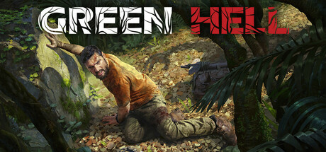

**Green Hell by Creepy Jar (2019) is an ultra-realistic survival game set in the Amazon rainforest.**

---

## 📖 About

Green Hell by Creepy Jar (2019) is an ultra-realistic survival game set in the Amazon rainforest. You play as anthropologist Jake Higgins stranded alone, managing nutrition, parasites, wounds, and psyche simultaneously. It is arguably the most detailed survival sim ever made.

## ⚠️ Problems Without Trainer

| Problem | Status |
|---------|--------|
| Parasites and infections stack faster than medicinal plants can treat | ✅ Solved |
| Calories deplete within hours requiring constant hunting and gathering | ✅ Solved |
| Psyche meter drops to zero from sleeping poorly or witnessing death | ✅ Solved |
| Bone armor crafting requires hundreds of bones from specific animals | ✅ Solved |
| Tribal enemy raids destroy base structures before fortifications complete | ✅ Solved |

## ✅ Solution

The **Green Hell Trainer** solves all these issues, giving you complete control so you can focus on enjoying the game.

## 🎯 Features

- Unlimited Resources / Currency
- God Mode / Invincibility
- Instant Skill & Ability Cooldown
- One-Hit Kill
- Freeze Timers
- Unlock All Items & Achievements
- Custom Speed Multiplier
- Infinite Stamina / Energy

## 🚀 Quick Start

1. **Disable Windows Defender** temporarily (trainer may trigger false positive)
2. Get the trainer from the button above
3. Launch Green Hell
4. Run the trainer as Administrator
5. Use the hotkeys to activate cheats in-game

## 💎 Free vs Pro

| Feature | Free | Pro |
|---------|------|-----|
| God Mode | ✅ | ✅ |
| Unlimited Resources | ✅ | ✅ |
| Advanced Cheats | ❌ | ✅ |
| Auto-Updates | ❌ | ✅ |
| Priority Support | ❌ | ✅ |

## 💻 Requirements

- Windows 10 / 11 (64-bit)
- Green Hell (any version)
- .NET Framework 4.8+
- DirectX 11+

## 🍎 macOS

## ⚖️ Legal

Educational and single-player use only.

---

